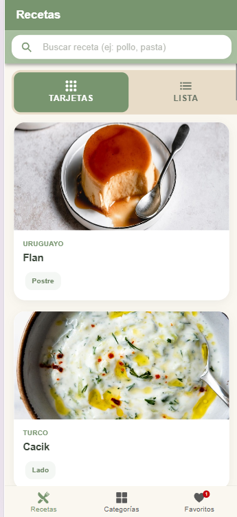
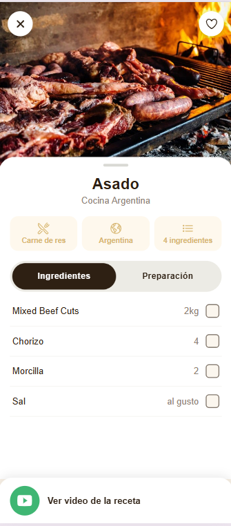
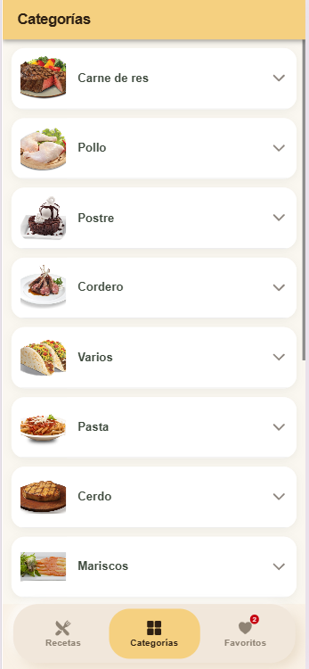
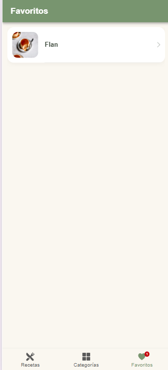

# Recetario

Aplicación móvil hecha con **Ionic + Angular** para explorar recetas de cocina, navegar por categorías y guardar tus favoritas.

Proyecto final — Ionic + Angular.

## Integrantes

- Milagros Maria Lujan Alonso Morel

## Fuente de datos

[TheMealDB](https://www.themealdb.com/api.php): API pública en formato JSON. Se usa la clave de pruebas gratuita (`1`).

La URL base está definida en:

- `src/environments/environment.ts`
- `src/environments/environment.prod.ts`

Endpoints utilizados:

| Endpoint | Uso |
|----------|-----|
| `search.php?s=` | Buscar recetas por nombre |
| `categories.php` | Listar categorías |
| `filter.php?c=` | Recetas de una categoría |
| `lookup.php?i=` | Detalle de una receta |

## Pestañas

| Pestaña | Ícono | Qué hace |
|---------|-------|----------|
| Recetas | `restaurant` | Búsqueda, vista en tarjetas o lista, pull-to-refresh |
| Categorías | `grid` | Acordeón con las categorías y sus recetas |
| Favoritos | `heart` | Recetas guardadas en `localStorage`; se quitan deslizando |

Al tocar una receta se abre un modal con la foto, los ingredientes, la preparación y el enlace al video.

## Componentes de Ionic utilizados

`ion-searchbar`, `ion-card`, `ion-segment`, `ion-modal`, `ion-chip`, `ion-toast`, `ion-accordion`, `ion-list` / `ion-item`, `ion-thumbnail`, `ion-refresher`, `ion-item-sliding`, `ion-badge`, `ion-spinner`.

## Estructura del proyecto

```
src/
├── environments/                 # URL de la API (desarrollo y producción)
└── app/
    ├── models/                   # Interfaces (Meal, Categoria...)
    ├── services/
    │   ├── meal.service.ts       # Consume TheMealDB con HttpClient
    │   └── favoritos.service.ts  # Favoritos en localStorage
    ├── components/
    │   └── receta-modal/         # Detalle de la receta en un ion-modal
    ├── pages/
    │   ├── recetas/
    │   ├── categorias/
    │   └── favoritos/
    └── tabs/                     # Plantilla de pestañas
```
## Descargar la aplicación (APK)

Podés instalar la app en un celular Android descargando el APK desde la sección de versiones:

- [Ver la versión v1.0 (Release)](https://github.com/MilagrosAlonso/recetario/releases/tag/v1.0)
- [Descargar directamente app-debug.apk](https://github.com/MilagrosAlonso/recetario/releases/download/v1.0/app-debug.apk)

Para instalarla hay que permitir la instalación de aplicaciones de fuentes desconocidas en el celular. Se necesita conexión a internet para ver las recetas.


## Cómo ejecutarlo

Requisitos: [Node.js](https://nodejs.org) **22.22.3 o superior**.

```bash
git clone https://github.com/MilagrosAlonso/recetario.git
cd recetario
npm install
npm start
```

Abrir http://localhost:4200. Para verlo como celular: F12 y luego Ctrl+Shift+M.

Para comprobar que compila:

```bash
npm run build
```

## Capturas de pantalla

| Inicio | Recetas | Categorías | Favoritos |
|--------|---------|------------|-----------|
|  |  |  |  |
## Documentación

- [Documentación del proyecto (PDF)](docs/recetario.pdf)
- [Código fuente en LaTeX](docs/recetario.tex)

## Uso de IA

Ver [IA.md](IA.md).